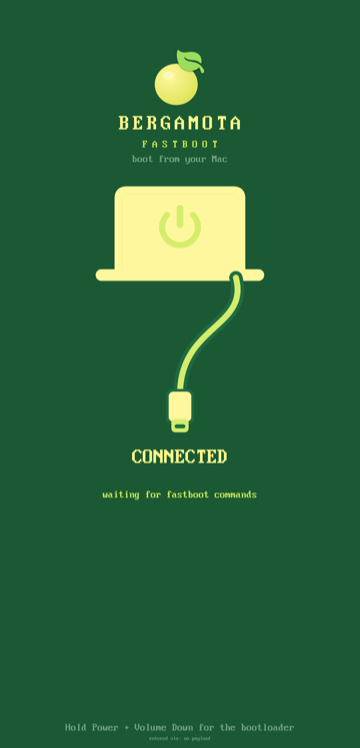
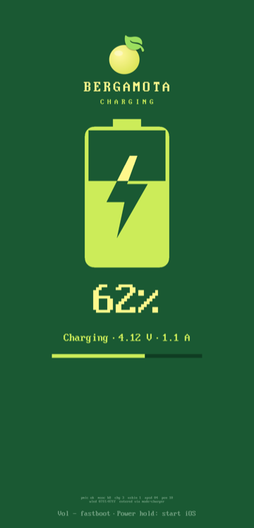

<p align="center">
  
</p>

<h1 align="center">Bergamota Project</h1>

<p align="center">
  <b>Apple's iOS 18 on a Poco F1</b><br>
  Xiaomi <code>beryllium</code> · Qualcomm Snapdragon 845 · iOS 18.7.8 (22H352)
</p>

<p align="center">
  
  
  
  
</p>

<p align="center"><sub>The face of the project is Isaac Newton, after Godfrey Kneller's 1689 portrait (public domain), printed as a halftone. Identity: <a href="tools/identity/IDENTITY.md"><code>tools/identity/IDENTITY.md</code></a>.</sub></p>

---

The Poco F1 boots the **unmodified iOS 18.7.8 userland of the iPhone XR** (`iPhone11,8`) to SpringBoard. It runs from its own UFS storage and is driven from a Mac over USB. Four parts make that work, each named after a piece of the bergamot tree:

| | Part | What it does | Where |
| --- | --- | --- | --- |
| 🍋 | **Bergamota** | The macOS control plane. It shows phone status and the live kernel log, builds boot images, and runs the boot and flash queue. A second-screen Control Plane view also handles sideloading and media upload. | [`apps/Bergamota`](apps/Bergamota) |
| 🌿 | **Enxerto** | The bootloader ("graft"). Qualcomm ABL starts it from the `boot` partition. It inflates the kernel with the MMU on, hands it a device tree and boots it. It also has its own fastboot and an off-mode charging screen. | [`enxerto/`](enxerto) |
| 🪵 | **Heartwood** | The kernel: Apple's open-source XNU (xnu-11215, the iOS 18 generation) plus our patches for the Snapdragon 845 hardware. It is built by GitHub Actions. | [`xnu/patches-11215`](xnu/patches-11215) |
| 🏴 | **Renegade** | The patcher. It rewrites every arm64e Mach-O and the whole dyld shared cache so they run on a CPU without pointer authentication. It then builds the flashable iOS root image. | [`tools/renegade`](tools/renegade) |

> [!WARNING]
> This is an experimental bring-up, not a usable phone OS. It installs into `userdata` and **erases Android's user data**. Apple's security model is mostly switched off, so do not put anything personal on it.

## The boot chain

```
Qualcomm ABL (stock, unlocked)
  └─ Enxerto            boot partition · logo + progress bar · Bergamota fastboot · charging screen
      └─ Heartwood      XNU + Apple Device Tree (@3x iPhone XR identity) + boot-args
          └─ HFS+ root  userdata · iOS 18.7.8, rewritten by Renegade
              └─ dyld → launchd → daemons → backboardd → SpringBoard
```

<p align="center">
  &nbsp;&nbsp;
  &nbsp;&nbsp;
  
</p>
<p align="center"><sub>Enxerto's screens, rendered by its host test: boot, Bergamota fastboot, off-mode charging</sub></p>

## Status

| Area | State |
| --- | --- |
| iOS | 18.7.8 (22H352) to **SpringBoard and the home screen**, with Safari, Settings and the other stock apps registered |
| CPU | All 8 cores (4× A55 + 4× A75). Instead of pointer authentication, the code is rewritten by Renegade |
| Display | 1080×2246 panel, iOS renders at @3x; page flipping on the MDP. **CPU rendering**, no GPU yet |
| Touch / buttons | Novatek NT36672A (bit-banged I²C), power and volume keys over SPMI |
| USB | CDC-ECM Ethernet: SSH at `root@192.168.7.2`, live kernel log on UDP 5140, internet shared from the Mac |
| Battery | Real fuel gauge and charger state; the off-mode charging screen lives in Enxerto |
| Kernel | Heartwood on **xnu-11215.81.4** since 2026-10-23 (it was xnu-8796, the iOS 16 generation, before that) |
| Working on | GPU acceleration on the Adreno 630 (OpenGL ES over Mesa freedreno, then Metal) |
| Not working | Wi-Fi, cellular, Bluetooth, audio, camera, sensors, SEP / Face ID, GPU acceleration |

## Getting started

You need a Mac (the Renegade root step also runs on Linux, see 3b), a Poco F1 with an **unlocked bootloader**, and a backup of its partitions (see [`NOTES.md`](NOTES.md)).

```sh
brew install --cask android-platform-tools
brew install aarch64-elf-gcc dtc blacktop/tap/ipsw
```

**0. The stock device tree.** Enxerto boots with your phone's own Qualcomm device tree (DTB). On the Poco F1 the ROM's `boot.img` is header v1. Its 21 DTBs are not in a separate section: they are appended to the gzipped kernel (`Image.gz-dtb`), so generic unpackers only give you `kernel`. `tools/extract-dtb.py` gunzips the kernel, splits off the DTBs and picks the one ABL would use:

```sh
# with the phone in OrangeFox/TWRP (adb root), save the stock boot image and the running device tree
adb pull /dev/block/by-name/boot backup/boot.img
adb pull /sys/firmware/fdt dtb/beryllium/live.dtb
python3 tools/extract-dtb.py backup/boot.img dtb/beryllium --live dtb/beryllium/live.dtb
# -> dtb/beryllium/rom-0..20.dtb and dtb/beryllium/dtb = "Beryllium MP v2.1" (msm-id 0x141 0x20001, board-id 0x45 0)
```

Without `--live`, it lists every blob (model, `qcom,msm-id`, `qcom,board-id`) and you choose with `--pick N`. `dtb/` and `backup/` are git-ignored, because they hold your phone's serial and calibration data. Enxerto's `build.sh` reads `dtb/beryllium/dtb`, or takes the path from `DTB=`.

**1. Heartwood (the kernel).** `develop` builds xnu-11215 (`xnu/patches-11215/`) on GitHub's macOS runners:

```sh
gh workflow run xnu.yml -R ry-diffusion/Bergamota -r develop
gh run list -R ry-diffusion/Bergamota -b develop -L 1                       # wait for it, ~20 min
gh run download <RUN_ID> -R ry-diffusion/Bergamota -n xnu-kernel -D xnu/out-develop
```

For a local single-file compile check before spending a CI run, see `tools/xnu-cc.py` and `docs/XNU11215_MIGRATION.md`.

**2. The Apple Device Tree.** Our ADT carries the iPhone identity (`/product`, copied from the real iPhone X device tree) and the Poco F1 hardware:

```sh
python3 tools/remotezip.py IPSW_URL DeviceTree.d22ap.im4p research/ipsw-x/dt      # any iPhone X (iPhone10,3) IPSW
ipsw img4 im4p extract research/ipsw-x/dt/Firmware/all_flash/DeviceTree.d22ap.im4p -o research/ipsw-x/d22ap.adt
python3 tools/mkadt.py enxerto/out/beryllium-hi-3x.adt --board beryllium --highmem --display-scale 3
```

**2b. GPU firmware (optional, for the Adreno 630).** It goes into the ADT, so nothing is written to the iOS root. It is Qualcomm's, so keep it out of git:

```sh
# a630_gmu.bin + a630_sqe.fw from linux-firmware (qcom/), the zap from sdm845-mainline/firmware-xiaomi-beryllium
python3 tools/zap-split.py a630_zap.mbn research/gpu-fw/zap
python3 tools/adt-gpufw.py enxerto/out/beryllium-hi-3x.adt enxerto/out/beryllium-hi-3x-gpu.adt \
    --fw research/gpu-fw/dl --zap research/gpu-fw/zap
```

**3. Renegade (the iOS root).** Download the iOS 18.7.8 root and build the image. No sudo is needed, but you need about 20 GB free. Renegade bakes everything in: app registration on first boot, the PosterBoard fix, the Bluetooth setup, Procursus + Sileo + TrollStore, the default wallpaper, and the `bglrender` launcher (see `tools/renegade/README.md`):

```sh
tools/renegade/renegade fetch-tools   # berga-tools.zip: the prebuilt on-device tools Renegade installs (below)
tools/renegade/renegade fetch         # root dmg + SystemOS/AppOS cryptexes, decrypted
tools/renegade/renegade root          # -> research/ios18/ios18-root-full.simg
tools/renegade/renegade update research/ios18/ios18-root-full.simg   # later: re-apply the tweaks in place
```

**3b. Renegade on Linux (Debian/Ubuntu).** The root image can be built and updated on Linux without compiling anything: `renegade fetch-tools` downloads the same prebuilt on-device tools as on a Mac. If you skip it, the tools that need Xcode (`sweetuicache`, `sweetfp`, the wallpaper tools, `sweetmetrics`, `sweetprefs`, the `bglrender` payload) are skipped automatically, with a summary at the end, unless prebuilt copies are in `research/sweetnet/` or `research/bergamota-gl/`. Everything that is plist or data still happens: launchd edits, preferences (battery %), event timing, Bluetooth environment, the jailbreak userland (Procursus, Sileo, TrollStore) and the dropbear job if its prebuilt binaries exist. It needs **root** (loop device and `mount -t hfsplus`) and the `hfsplus` kernel module:

```sh
sudo apt install python3 curl hfsprogs util-linux zstd dropbear-bin cmake g++ git libfuse3-dev libbz2-dev zlib1g-dev libattr1-dev fuse3
# ipsw: the .deb from https://github.com/blacktop/ipsw/releases ; apfs-fuse (not in the archives): build https://github.com/sgan81/apfs-fuse
tools/renegade/renegade fetch                    # ipsw: root dmg + cryptexes, decrypted
sudo -E tools/renegade/renegade root             # -> research/ios18/ios18-root-full.simg (the ldid signer is downloaded and SHA-256 checked)
sudo -E tools/renegade/renegade update research/ios18/ios18-root-full.simg
RENEGADE_DRY_RUN=1 tools/renegade/renegade root  # prints the mkfs/losetup/mount/apfs-fuse/ldid commands, runs nothing
```

Details, the macOS/Linux matrix and what is not verified yet: `tools/renegade/README.md`, "Platforms".

**3c. berga-tools.zip (the prebuilt on-device binaries).** The small programs Renegade puts into the root (`sweetuicache`, `sweetfp.dylib`, `sweetmetrics`, the wallpaper tools, `SweetRun.app`, `sweetreboot`, ...) and the `bglrender` payload (the EAGL shim, Mesa's `libOSMesa`, our `libdrm` stand-in) are compiled for the phone, so most people should not build them. They are published as `berga-tools.zip` on the [releases page](https://github.com/ry-diffusion/Bergamota/releases) (tags `berga-tools-vN`). `renegade fetch-tools` downloads the newest one, checks it and unpacks it into a cache; it needs only Python 3, on macOS and on Linux, no `gh`:

```sh
tools/renegade/renegade fetch-tools                       # newest berga-tools-vN -> ~/.cache/bergamota/berga-tools
tools/renegade/renegade fetch-tools --tag berga-tools-v1  # a specific one
tools/renegade/renegade fetch-tools --zip ~/Downloads/berga-tools.zip   # a zip you downloaded yourself (offline)
tools/renegade/renegade fetch-tools --status              # what is installed and where Renegade will look
```

`renegade root` and `renegade update` use a binary you built yourself (`research/sweetnet/`, `research/bergamota-gl/`, `$RENEGADE_SWEETNET`, `$RENEGADE_BGL`) first, and the cache only when it is missing. The zip is checked against its SHA-256 (the release's, when it publishes one) and every file in it against the `berga-tools.json` manifest (SHA-256, size, architecture, commit it was built from). A feature whose binary is in neither place is skipped with a message, as before. The zip holds only our own code and the Mesa build, never anything of Apple's or Qualcomm's (`LICENSES/NOTICE.txt` in the zip). The cache is `$RENEGADE_TOOLS_CACHE` if set; `$RENEGADE_BERGA_TOOLS` points at an already unpacked directory.

**Building the tools yourself.** Only needed if you changed the sources in `tools/sweetnet/` or `gpu/eagl/`, or you do not want to run our binaries. It needs a Mac with **Xcode** (the full app, not only the command line tools: the build uses the iPhone SDK through `xcrun -sdk iphoneos`, plus `codesign`) and Python 3. There is no Linux build and no Docker/VM route.

```sh
xcode-select -p && xcrun -sdk iphoneos --show-sdk-version         # both must work
tools/sweetnet/build.sh                      # -> research/sweetnet/ (iOS 16 arm64) and research/sweetnet/ios18/ (arm64e, then `renegade strip --sign`)
TOOLS="hcitest sweetreboot" IOS18=0 tools/sweetnet/build.sh       # a subset; IOS18=0 skips the iOS 18 builds
```

The GL payload (`bglrender`) is built from the `gpu-eagl` branch, not from `develop`: Mesa 25.0.7 is cross-built for iOS (about 1.6 GB of scratch space, `brew install meson bison`), then the shim and the launcher are compiled and signed. `docs/GPU_EAGL.md` on that branch has the details:

```sh
git worktree add ../ios-beryllium-gpu-eagl gpu-eagl && cd ../ios-beryllium-gpu-eagl
export GPU_EAGL_WORK=$HOME/gpu-eagl-work                   # scratch directory
gpu/eagl/mesa/build-mesa.sh                                # Mesa for arm64e (long)
gpu/eagl/make-payload.sh                                   # -> research/bergamota-gl/ (bgl-launch, OpenGLES.framework, libOSMesa, libdrm)
export RENEGADE_BGL=$PWD/research/bergamota-gl             # or copy it into research/bergamota-gl/ of your checkout
```

To make your own `berga-tools.zip` (to share it, or to test what a release would contain):

```sh
tools/berga-tools/package.sh                               # builds tools/sweetnet, then packages -> research/berga-tools-out/berga-tools.zip (+ .sha256)
BUILD=0 tools/berga-tools/package.sh                       # package the binaries that are already built
tools/renegade/renegade fetch-tools --zip research/berga-tools-out/berga-tools.zip
```

`package.sh` takes only an allowlist of files, refuses anything that looks like firmware, an image or a dump, refuses binaries that link anything but system libraries by path, and reads the finished zip back against its manifest. Publishing is `gh release create berga-tools-vN research/berga-tools-out/berga-tools.zip research/berga-tools-out/berga-tools.zip.sha256 --prerelease` (`BERGA_TOOLS_VERSION=N` when packaging). From berga-tools-v2 the zip also carries the dropbear/dash/toybox SSH binaries of `research/ssh-build/out/` (third-party, built by `tools/ssh/build.sh`, license texts in `LICENSES/`): dash is the image's `/bin/sh`, which the first-boot job (app registration, jailbreak post-install) needs, so a Linux build without them fails `verify`.

**4. Enxerto (the boot image).** Pack the kernel, the ADT and the boot-args into an Enxerto boot image. It also takes the Apple logo for the boot screen from your root image, so it is never committed:

```sh
# plain iOS
DTB=dtb/beryllium/dtb tools/renegade/mkboot-full.sh xnu/out-develop/kernel.development.sweet \
    enxerto/out/beryllium-hi-3x.adt enxerto/out/enxerto-boot-develop.img
# with the GPU kept up (sweetgpu=8) and its firmware ADT, as in our tests
CMDLINE="$(sed -n 's/^CMDLINE=${CMDLINE:-"\(.*\)"}$/\1/p' tools/renegade/mkboot-full.sh) sweetgpu=8 ufslogsecs=1" \
DTB=dtb/beryllium/dtb tools/renegade/mkboot-full.sh xnu/out-develop/kernel.development.sweet \
    enxerto/out/beryllium-hi-3x-gpu.adt enxerto/out/enxerto-boot-develop-gpu.img
```

**5. Flash and boot with Bergamota.** Open `apps/Bergamota/Bergamota.xcodeproj` and run it. Bergamota fastboot (`enxerto/out/bergamota-fastboot.img`, built by `enxerto/build.sh`) can flash `userdata`, `boot` and `logo` itself. It flashes `userdata` as a **delta**: it hashes what is on the phone and sends only the changed blocks:

```sh
fastboot boot enxerto/out/bergamota-fastboot.img                                  # from ABL fastboot (Power + Volume Down)
python3 tools/bergamota-flash.py flash userdata research/ios18/ios18-root-full.simg   # delta, verified
python3 tools/bergamota-flash.py flash boot enxerto/out/enxerto-boot-develop-gpu.img  # optional: make it the cold-boot image
apps/Bergamota/scripts/bergamota enqueue enxerto/out/enxerto-boot-develop-gpu.img     # or just RAM-boot it from the queue
```

The first boot takes a few minutes while the first-boot job registers the apps. Then `ssh root@192.168.7.2`. On iOS with an xnu-11215 kernel, `sweetreboot fastboot` and `sweetreboot bergamota` get you back to fastboot without the buttons.

## Troubleshooting

**"I unpacked the boot image but there is no DTB."** The Poco F1 boot.img appends the DTBs to the gzipped kernel, so unpackers don't show them. Pull the latest `develop` and, with the phone in OrangeFox:

```sh
adb pull /dev/block/by-name/boot backup/boot.img
adb pull /sys/firmware/fdt dtb/beryllium/live.dtb
python3 tools/extract-dtb.py backup/boot.img dtb/beryllium --live dtb/beryllium/live.dtb
```

That writes `dtb/beryllium/dtb`, which Enxerto's `build.sh` uses.

**Bergamota shows "REMOTE HOST IDENTIFICATION HAS CHANGED".** Every new iOS root generates a new SSH host key for `192.168.7.2`, so the old entry in `~/.ssh/known_hosts` no longer matches. Remove it with `ssh-keygen -R 192.168.7.2`. If you switch between roots often, keep a separate file instead (`-o UserKnownHostsFile=~/.ssh/known_hosts_ios18`).

## Renegade, briefly

On iOS 18 every system binary is **arm64e**, but the Snapdragon 845 (ARMv8.2) has no pointer authentication. Renegade rewrites the code 4 bytes for 4 bytes, so no offset, branch, unwind table or fixup chain moves:

```
RETAA / RETAB           →  RET
BRAA / BLRAA …          →  BR / BLR
LDRAA / LDRAB           →  LDR
PACIA / AUTIA / XPACI…  →  NOP
PACGA Xd, Xn, Xm        →  EOR Xd, Xn, Xm, ROR #13
```

It does this for every Mach-O in the root and for all of the dyld shared cache. It then re-signs each binary ad hoc (keeping its identifiers and entitlements), recomputes corecrypto's FIPS HMAC and sets the HFS+ owners without root. Heartwood's side of the deal (`sweetarm64e=1`) lets arm64e binaries load and emulates FJCVTZS. See [`tools/renegade/README.md`](tools/renegade/README.md) and [`docs/IOS18_PORT.md`](docs/IOS18_PORT.md).

## Repository layout

| Path | What |
| --- | --- |
| `apps/Bergamota/` | Bergamota, the SwiftUI control plane, plus its CLI (`scripts/bergamota`) |
| `enxerto/` | Enxerto, the bare-metal bootloader (C + asm): loader, inflate, UFS, USB/DWC3, fastboot, PMIC, boot UI |
| `xnu/patches-11215/` | Heartwood, the XNU patch series (xnu-11215), applied in order by `.github/workflows/xnu.yml`; `xnu/patches/` is the older xnu-8796 series |
| `tools/renegade/` | Renegade: `pacstrip*`, `fips_rehmac`, root build, HFS+ and sparse-image tools, `dsctools` (shared-cache symbolication) |
| `tools/adt-gpufw.py`, `zap-split.py` | GPU firmware into the ADT (`/sweet-gpu`); split a squashed `.mbn` into `.mdt` + `.bNN` |
| `tools/bergamota-flash.py` | Delta/full flashing of userdata, boot and logo through Bergamota fastboot |
| `tools/extract-dtb.py` | Extracts the stock DTBs from a boot.img (also the Poco F1's appended Image.gz-dtb) and picks yours |
| `tools/mkadt.py`, `mkpayload.py` | Apple Device Tree generator; kernel + ADT + boot-args payload packer |
| `tools/sweetnet/` | Small on-device tools (`sweetps`, `sweetprefs`, `sweetuicache`, …) |
| `tools/identity/` | The Bergamota identity (Newton halftone, lime ground, Archivo + JetBrains Mono): `mkidentity.py` generates Enxerto's `art.h` and the kernel console's portrait, `mkicon.sh` the app icon |
| `tools/mksplash.py` | The ABL screens of the `logo` partition, from Enxerto's own renders |
| `docs/` | Design notes: iOS 18 port, Bergamota fastboot and charging, GPU research, … |
| `NOTES.md` | The engineering log: every boot, crash and decision |

Not in git: partition backups, device trees, Apple firmware and root images, or anything with serial numbers or calibration data.

## Credits

This started as a fork of [ios-sweet](https://github.com/dipa-studio/ios-sweet) (iOS 16 on the Redmi Note 10 Pro). The iOS 16 days of this port are in [`docs/IOS16_README.md`](docs/IOS16_README.md). It is built on Apple's open-source releases (xnu, IOHIDFamily, libpthread, hfs), [BearSSL](https://bearssl.org), [blacktop/darwin-xnu-build](https://github.com/blacktop/darwin-xnu-build) and [ipsw](https://github.com/blacktop/ipsw), the Linux kernel's SDM845 drivers for the hardware details, and [OrangeFox Recovery](https://orangefox.download). iOS itself is Apple's and is not distributed here.
